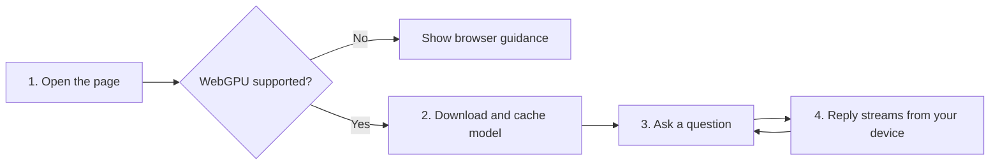

<div align="center">

# 🎓 CampusBuddy

### *Your Free, Private AI Study Companion.*

**An open-source AI chat for students that runs entirely in your browser using WebLLM and WebGPU. No server, no API key, no usage limits.**

[](https://chatbot-beta-rose-99.vercel.app)
[](#-features)
[](#️-tech-stack)
[](#)

[**🚀 Live Demo**](https://chatbot-beta-rose-99.vercel.app) · [**✨ Features**](#-features) · [**🧭 How It Works**](#-how-it-works) · [**⚙️ Getting Started**](#️-getting-started) · [**🤝 Contributing**](#-contributing)

</div>

---

## 📌 Table of Contents

- [About the Project](#-about-the-project)
- [The Problem](#-the-problem)
- [Our Solution](#-our-solution)
- [Features](#-features)
- [How It Works](#-how-it-works)
- [Models](#-models)
- [Tech Stack](#️-tech-stack)
- [Getting Started](#️-getting-started)
- [Customize](#️-customize)
- [Project Structure](#-project-structure)
- [Requirements](#️-requirements)
- [Roadmap](#️-roadmap)
- [Contributing](#-contributing)
- [Author](#-author)

---

## 📖 About the Project

**CampusBuddy** is a friendly AI assistant for college students. Ask about study tips, concept explanations, exam planning, coding, careers and campus life. The language model runs **directly on your device**, so your conversations never leave your browser.

🔗 **Live application:** [chatbot-beta-rose-99.vercel.app](https://chatbot-beta-rose-99.vercel.app)

---

## ❗ The Problem

- Most AI chat tools need **accounts, API keys or paid plans**.
- Student conversations are **sent to remote servers**, raising privacy concerns.
- Usage **limits and quotas** interrupt studying.
- Hosting a chatbot normally needs a **backend and ongoing costs**.

## 💡 Our Solution

CampusBuddy moves the AI to the user's device:

1. **Load** the page in a WebGPU browser.
2. **Download** the model once, then it is cached.
3. **Chat** with replies generated locally and streamed live.
4. **Stay private**, with no server involved at all.

---

## ✨ Features

| | Feature | Description |
|---|---|---|
| 🔒 | **Private by design** | All inference happens locally. No data is sent to a server. |
| 💸 | **Free and unlimited** | No API keys, quotas or subscriptions. |
| ⚡ | **Two model options** | Switch between a fast model and a smarter one. |
| 💬 | **Streaming replies** | Responses appear token by token as they are generated. |
| 📦 | **Cached after first load** | The model downloads once, then loads quickly. |
| 🌗 | **Light and dark mode** | Follows your system theme automatically. |
| 📱 | **Responsive layout** | A clean chat UI that adapts to any screen. |

---

## 🧭 How It Works



| Step | What happens |
|:---:|---|
| **1** | **Open the page.** CampusBuddy checks for WebGPU support. |
| **2** | **Load the model.** The first visit downloads it, with a progress bar. |
| **3** | **Ask anything** about studies, coding or careers. |
| **4** | **Get streamed answers** generated entirely on your device. |

---

## 🧠 Models

| Option | Model | Best for |
|---|---|---|
| **Fast (small)** | SmolLM2-360M-Instruct | Quick responses on modest hardware |
| **Smarter (1.5B)** *(default)* | Qwen2.5-1.5B-Instruct | Better reasoning and answers |

---

## 🛠️ Tech Stack

| Layer | Technology |
|---|---|
| **Frontend** | HTML5, CSS3, vanilla JavaScript (ES modules) |
| **AI Engine** | [WebLLM](https://github.com/mlc-ai/web-llm) (`@mlc-ai/web-llm`) |
| **Acceleration** | WebGPU |
| **Deployment** | Vercel |

---

## ⚙️ Getting Started

### Prerequisites

- A browser with **WebGPU** support (recent Chrome, Edge or Brave)
- [Node.js](https://nodejs.org/) (only to run a local static server)

### Installation

```bash
# 1. Clone the repository
git clone https://github.com/raunakdubey7891-del/Chatbot.git

# 2. Move into the project folder
cd Chatbot
```

### Run Locally

```bash
# ES modules need a server, not file://
npx serve .
```

Open the local URL in your browser. The first visit downloads the model, so keep the tab open until the progress bar completes.

---

## 🎛️ Customize

Everything lives in `index.html`:

- **Persona:** edit the `SYSTEM` prompt to change how CampusBuddy behaves.
- **Models:** add or swap entries in the `#model` dropdown using any model ID from the [WebLLM model list](https://github.com/mlc-ai/web-llm).

---

## 📁 Project Structure

```
Chatbot/
├── index.html    # UI and chat logic
└── style.css     # Styling
```

---

## ⚠️ Requirements

- A browser with **WebGPU** support (recent Chrome, Edge or Brave)
- A laptop or desktop is recommended. Mobile support depends on the device and browser.
- A one-time model download on first use

---

## 🗺️ Roadmap

- [x] In-browser AI chat with WebLLM
- [x] Fast and smarter model options
- [x] Streaming responses
- [x] Light and dark themes
- [ ] Saved chat history
- [ ] Markdown and code formatting in replies
- [ ] More model choices
- [ ] Voice input

---

## 🤝 Contributing

Contributions, issues and feature requests are welcome!

1. Fork the project
2. Create your feature branch: `git checkout -b feature/amazing-feature`
3. Commit your changes: `git commit -m "Add amazing feature"`
4. Push to the branch: `git push origin feature/amazing-feature`
5. Open a Pull Request

---

## 👤 Author

**Raunak Dubey**
MCA, Pondicherry University

[](https://github.com/raunakdubey7891-del)

---

<div align="center">

⭐ If you like this project, please consider giving it a star! ⭐

*Made with ❤️ for students.*

</div>
